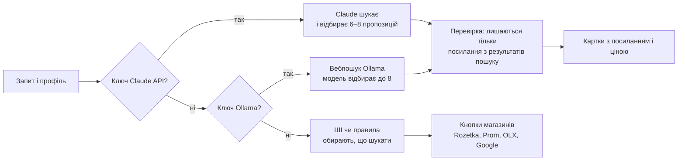

# Поради бабусі — опис проєкту

Оновлено 13.10.2026. Це копія живого документа з описом проєкту; нові доробки записуються в «Журнал змін» унизу.

## Що це за проєкт

«Поради бабусі» — сайт-застосунок, який допомагає парам робити стосунки теплішими. Він дає щоденні поради від бабусі Ганни, підбирає подарунки, вчинки й побачення під конкретну людину, нагадує про важливі дати й об’єднує спільноту бабусь-порадниць.

- **Для кого:** люди, які хочуть зміцнити стосунки, молоді пари й ті, хто шукає натхнення для романтики. Інтерфейс українською.
- **Головна героїня:** бабуся Ганна, 74 роки, 52 роки в шлюбі з дідом Петром. Тепла, з гумором і прислів’ями; її слова написані «від руки» в бабусиному зошиті.
- **Користь для бабусь:** літні жінки мають профілі, записують короткі аудіо- та відео-поради, відповідають на питання й заробляють на консультаціях. Це і дохід, і відчуття потрібності.

Як проєкт заробляє:

| Джерело | Ціна | Що отримує людина |
| --- | --- | --- |
| Підписка «Бабусина скриня» | 99 ₴ на місяць або 799 ₴ на рік, перші 7 днів безкоштовно | Усі 31 порада, безлімітний ШІ-підбір і розмови з бабусею, нагадування за 7 і 14 днів |
| Донат «Пригостити бабусю» | 25, 50, 150 ₴ або своя сума | Підтримка проєкту й подяка від бабусі |
| Консультація з бабусею | Від 150 до 450 ₴ залежно від бабусі й формату | Відео-, аудіодзвінок або листування; 80 % оплати отримує бабуся, 20 % — платформа |

Безкоштовно доступні порада дня й перші 10 порад, 3 ШІ-підбори ідей і 2 питання бабусі в чаті на день.

## Як відкрити й запустити

Сайт працює трьома способами, і від способу залежить, чи є ШІ та пошук в інтернеті.

| Спосіб | Як відкрити | ШІ | Пошук товарів |
| --- | --- | --- | --- |
| У Claude | За посиланням на опублікований сайт | Claude у браузері | ШІ підбирає, що шукати, і відкриває пошук у магазинах |
| На комп’ютері з ШІ | Двічі клацнути «Запустити з ШІ.bat» у папці проєкту | Ollama (безкоштовно) або Claude API (за ключем) | Справжній пошук в інтернеті з ключем Ollama або Claude API |
| Просто файл | Двічі клацнути «Поради бабусі.html» | Немає, ідеї за правилами | Посилання на пошук у магазинах за профілем |

Запуск на комп’ютері з ШІ:

1. Встановити [Python 3](https://www.python.org/downloads/) і під час встановлення поставити галочку «Add python.exe to PATH».
2. Встановити [Ollama](https://ollama.com) і один раз виконати в терміналі `ollama pull gemma3:4b`. Сервер сам знаходить Ollama й модель.
3. Двічі клацнути «Запустити з ШІ.bat». Під час першого запуску сервер сам створить `ai-settings.txt` із шаблону `ai-settings.example.txt`.
4. Для пошуку в інтернеті створити безкоштовний акаунт Ollama, ключ на [ollama.com/settings/keys](https://ollama.com/settings/keys) вписати в `ai-settings.txt`, рядок `OLLAMA_API_KEY=`.
5. За бажання замість Ollama вписати ключ [Claude API](https://platform.claude.com/settings/keys) в рядок `ANTHROPIC_API_KEY=`: краща українська й пошук через Claude, але платно.
6. Після змін у налаштуваннях закрити чорне вікно й запустити «Запустити з ШІ.bat» знову. Сайт відкривається на http://127.0.0.1:8000, а в чорному вікні видно, яку модель і який пошук знайдено.

Команда `ollama launch claude` для сайту не потрібна: вона запускає Claude Code (агента для програмування), а не модель Claude.

## Розділи сайту

Сайт має шість розділів; на ноутбуці вони в меню зліва, на телефоні — внизу екрана.

| Розділ | Що там |
| --- | --- |
| Сьогодні | Привітання бабусі, порада дня з маленьким завданням, найближча дата, ідея дня, рекомендована бабуся-порадниця, чат «Спитати бабусю» |
| Поради | «Скриня порад»: 31 порада в 6 темах (турбота, сварки, увага, слова, побут, романтика), прогрес прочитаного, збережені поради |
| Бабусі | Шість профілів бабусь з аудіо- й відео-порадами, підбір за віком (модель з розділу нижче), питання бабусі, платні консультації; режим «Я бабуся» — кабінет із заробітком, відповідями та записом порад |
| Ідеї | Подарунки, вчинки й побачення для коханої людини (за правилами або від ШІ), вкладка «Знайти» з розумним пошуком в інтернеті, збережені й уже зроблені ідеї |
| Дати | Важливі дати з відліком днів, свята, налаштування сповіщень (порада дня, за скільки днів нагадувати, ідеї на вихідні) |
| Профіль | Все про кохану людину: інтереси, улюблене, дати, звички, мова любові, алергії; дані про себе (ім’я, вік), підписка, донати, фото бабусі |

- **Знайомство (опитування).** При першому запуску бабуся за 9 кроків розпитує про користувача (ім’я, вік, як звертатися) і про кохану людину, а також пропонує увімкнути сповіщення. Є кнопка «Заповнити прикладом» для тесту.
- **Розмова з бабусею.** Чат, де ШІ відповідає голосом бабусі Ганни; при ознаках насильства вона радить гарячу лінію 116 123 або 102.
- **Для тестувальників.** У меню (на телефоні — внизу профілю) є блок із сценарієм тесту, перемикачем підписки та кнопкою «Стерти все».

## Модель машинного навчання

За віком користувача модель оцінює ймовірність чотирьох життєвих етапів і за ними радить тему й бабусю; на тестових даних вона вгадує етап у 62 % випадків проти 46 % у базової.

| Що | Значення |
| --- | --- |
| Тип навчання | Навчання з учителем (для кожного запису відома правильна відповідь) |
| Алгоритм | Багатокласова логістична регресія (регресійний класифікатор), scikit-learn |
| Ознаки | Вік, вік², вік³; вік понад 80 рахується як 80 |
| Класи | Ще не в шлюбі · У шлюбі · Розлучення / окремо · Вдівство |
| Дані | [UCI Adult (Census Income)](https://archive.ics.uci.edu/dataset/2/adult), перепис США 1994 р., 48 842 записи, ліцензія CC BY 4.0 |
| Розбиття | 39 073 записи для навчання, 9 769 для тесту |
| Точність (accuracy) | 62 % на тесті; 62,5 % у 5-кратній перехресній перевірці; базова модель «завжди у шлюбі» — 46 % |

Етапи перетворюються на теми так: «не в шлюбі» → Стосунки, «у шлюбі» → Сім’я, «розлучення» → Підтримка, «вдівство» → Доброта й Підтримка. Бабусі сортуються за тим, наскільки їхні теми збігаються з цими вагами.

- **Чому без статі.** У наборі заміжніми записано лише 15,5 % жінок проти 61 % чоловіків. Зі статтю точність сягала б 68 %, але жінкам сайт радив би переважно поради про розлучення. Експеримент описано в розділі 6 ноутбука.
- **Межа однієї ознаки.** Розлучення й вдівство модель ніколи не називає найімовірнішими, тому сайт показує всі чотири ймовірності, а тему можна обрати вручну.
- **Де рахується.** Прямо в браузері за коефіцієнтами з `ml/model.json`; ймовірності збігаються з ноутбуком. Дані зі США 1994 року, тож це навчальна демонстрація.

## ШІ й розумний пошук

ШІ обирається сам у такому порядку: Claude у браузері, потім ключ Claude API, потім Ollama на комп’ютері; якщо нічого немає, сайт працює за правилами. ШІ підбирає ідеї, говорить у чаті голосом бабусі, дає демо-відповіді бабусь і допомагає розумному пошуку.

**Розумний пошук** (Ідеї → Знайти) шукає подарунки, послуги й враження, які підійдуть саме цій людині. Він враховує запит користувача, тип пропозиції, бюджет, місто, профіль (інтереси, улюблене, мова любові, алергії) і найближчий привід, якщо дата в межах 30 днів. Кнопка з лупою на картці ідеї запускає пошук саме цієї ідеї.

| Режим пошуку | Коли вмикається | Як працює | Вартість |
| --- | --- | --- | --- |
| Claude з вебпошуком | У `ai-settings.txt` вписано ключ Claude API | Claude сам робить до 5 пошуків, відбирає 6–8 пропозицій і пояснює вибір | [Близько 10 $ за 1000 пошуків](https://platform.claude.com/docs/en/agents-and-tools/tool-use/web-search-tool) плюс токени |
| Вебпошук Ollama | У `ai-settings.txt` вписано `OLLAMA_API_KEY` | Модель складає 3 запити, [Ollama](https://docs.ollama.com/capabilities/web-search) шукає, модель відбирає до 8 результатів | Безкоштовний акаунт Ollama |
| Посилання на магазини | Ключів немає або сайт відкрито в Claude | ШІ або правила підбирають, що шукати; кнопки відкривають пошук у Rozetka, Prom, OLX, Google і Google Картах | Безкоштовно |

З ключем Claude API чи Ollama пошук йде в інтернет і проходить перевірку посилань; без ключів сайт лише підказує, що шукати, і відкриває магазини.

- **Тільки справжні посилання.** Сервер показує лише ті адреси, які реально повернув пошук; посилання, вигадане моделлю, відкидається. Ціна показується, лише коли вона є на сторінці, і її варто перевіряти в магазині.
- **Ключі в безпеці.** Ключі лежать лише в `ai-settings.txt` на комп’ютері й не потрапляють у браузер чи в git. Сервер приймає запити тільки з цього комп’ютера й не віддає сам файл з ключами.
- **Збереження.** Знайдене можна зберегти в закладки разом із посиланням.

## Файли проєкту

Проєкт лежить у репозиторії [Grandma-s-Tips](https://github.com/Denis0958724/Grandma-s-Tips) на GitHub. Сам сайт — один HTML-файл без зовнішніх залежностей, крім шрифтів Google Fonts.

| Файл | За що відповідає |
| --- | --- |
| `Поради бабусі.html` | Увесь сайт: вигляд, логіка, 31 порада, профілі бабусь, коефіцієнти моделі |
| `server.py` | Локальний сервер: віддає сайт, передає запити до ШІ й шукає в інтернеті; потрібен лише Python 3.9+ |
| `Запустити з ШІ.bat` | Запускає сервер і відкриває сайт у браузері (Windows) |
| `ai-settings.example.txt` | Шаблон налаштувань; з нього сервер сам створює `ai-settings.txt` (модель Ollama, `OLLAMA_API_KEY`, ключ Claude API). `ai-settings.txt` з ключами секретний і в git не потрапляє |
| `ml/life_stage_classifier.ipynb` | Jupyter-ноутбук: дані, навчання, метрики, графіки, експеримент зі статтю, експорт |
| `ml/adult.csv` | Відкритий набір UCI Adult (48 842 записи) |
| `ml/model.json` | Навчена модель; після перенавчання її вміст копіюють у константу `MODEL` сайту |
| `README.md` | Коротка інструкція запуску |
| `ОПИС_ПРОЄКТУ.md` | Цей опис |
| `.gitignore`, `.gitattributes` | Не дають викласти `ai-settings.txt` у git і зберігають віндовські кінці рядків для `.bat` і `.txt` |

Дані користувача (профіль, дати, питання, збережене) сайт зберігає в браузері (localStorage), а не в цих файлах.

## Що імітовано й обмеження

Це прототип для тестів на користувачах і ТЗ для розробників: гроші, бабусі й сповіщення в ньому несправжні.

- **Оплата й донати** імітуються: гроші не списуються, виплат бабусям немає.
- **Бабусі вигадані.** Їхні аудіо- й відео-поради озвучуються синтезом мовлення з субтитрами; без українського голосу в браузері показуються лише субтитри. Відповіді бабусь від ШІ позначені як демо.
- **Власні записи бабусь** (мікрофон, камера або файл) живуть до перезавантаження сторінки. В опублікованій у Claude версії працює лише завантаження файлу.
- **Сповіщення** — банер у кутку екрана; справжні push-сповіщення не надсилаються.
- **Дані лише в браузері.** Реєстрації, акаунтів і бази даних немає; питання й записи на консультації видно лише в тому самому браузері.
- **Модель навчена на даних США 1994 року**, тож для України це навчальна демонстрація.
- **Якість ШІ залежить від моделі:** у Claude українська найкраща, легкі моделі Ollama пишуть простіше.
- **Пошук у магазинах без ключів** відкриває сторінки пошуку Rozetka, Prom і OLX; якщо магазин змінить формат адрес, кнопку треба буде оновити.

## Журнал змін

Нові доробки додаються зверху таблиці.

| Дата | Що змінилося | Коротко |
| --- | --- | --- |
| 13.10.2026 | Проєкт на GitHub | Код, модель, дані й цей опис викладено в [Grandma-s-Tips](https://github.com/Denis0958724/Grandma-s-Tips); замість файлу з ключами там шаблон `ai-settings.example.txt`, з якого сервер сам створює `ai-settings.txt` |
| 10.10.2026 | Розумний пошук | Вкладка «Знайти»: подарунки, послуги й враження з інтернету через Claude API або Ollama, або посилання на магазини; кнопка пошуку на картках ідей |
| 10.10.2026 | Опис проєкту | Документ із журналом змін |
| 05.10.2026 | Ollama без налаштувань | Сервер сам знаходить Ollama й модель, прибирає міркування `<think>`, підказує, яку команду виконати |
| 05.10.2026 | ШІ на своєму комп’ютері | `server.py` і «Запустити з ШІ.bat»: ШІ через Claude API або Ollama, ключ залишається на комп’ютері |
| 05.10.2026 | Модель і розділ «Бабусі» | Логістична регресія за віком на UCI Adult і Jupyter-ноутбук; профілі бабусь, аудіо- й відео-поради, питання, консультації, кабінет бабусі; вік у знайомстві |
| 04.10.2026 | Сайт замість «телефона» | На ноутбуці меню зліва й картки в кілька колонок, на телефоні нижнє меню |
| 04.10.2026 | Виправлення | Іконки нормального розміру; нові ідеї не повторюють виконані, список «Уже зроблено» |
| 04.10.2026 | Перша версія | Знайомство, 31 порада, профіль партнера, ШІ-ідеї, дати й сповіщення, підписка й донати (демо) |
